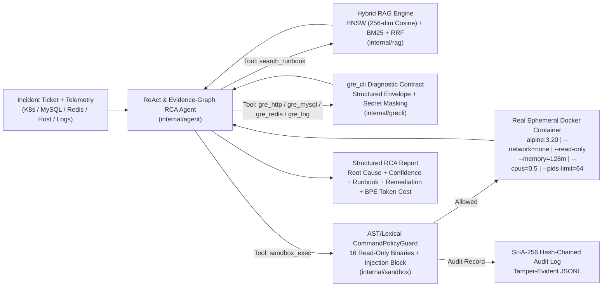

# SRE Operations & Root Cause Analysis (RCA) Agent (`llm-agent`)

生产级 Go 语言 **SRE 智能运维诊断与根因定位（RCA）Agent 系统**，面向高可用分布式与微服务基础设施，深度对齐 `gre_cli` 混合云诊断契约（HTTP / MySQL / Redis / Log / K8s / Host），提供 **HNSW + Okapi BM25 + RRF 混合检索**、**真实 Docker 隔离容器沙箱（`--network=none --read-only`）**、**ReAct 多步证据图推理** 以及 **100 条历史故障工单 3 策略消融评测基准**。

> **历史归档说明**：原 75 天 LLM 学习练习脚本与示例目录已完整归档至独立分支 `backup/legacy-75days-mock`（Commit `75e8fea`），主分支聚焦生产级 Go SRE 诊断 Agent 工程实现。

---

## 1. 核心架构与工程特性



### 四大核心子系统

1. **混合检索与知识库引擎（`internal/rag/`）**
   - **双模 Dense Embedder（`embedder.go`）**：支持 `OpenAI HTTP API`（配置 `OPENAI_API_KEY` 时自动启用）与确定性本地 `Subword Char N-Gram (2..4) + Word Bigram + 领域技术词根加权 + Johnson-Lindenstrauss 256 维正交随机投影 + L2 归一化` 嵌入器。
   - **自研多层 HNSW 图向量索引（`hnsw.go`）**：纯 Go 实现 Malkov & Yashunin 2018 多层导航小世界图（`M=16, efConstruction=100, efSearch=64`），支持增量插入、余弦距离搜索与 JSON 持久化。
   - **Okapi BM25 倒排索引（`bm25.go`）**：支持中英文双语与下划线/驼峰/错误码切词（`k1=1.5, b=0.75`），精准捕捉 `ERR_REDIS_OOM`、`CrashLoopBackOff`、`Error 1213` 等精确标识符。
   - **Reciprocal Rank Fusion 混合检索（`hybrid.go`）**：通过 `RRF(d) = w_v/(k + r_vec(d)) + w_b/(k + r_bm25(d))` 融合语义向量与精确词法召回，内置 10 大 SRE 故障域共 30 篇生产级 Runbook / Postmortem / SOP（`data/runbooks/sre_knowledge_base.jsonl`）。

2. **真实 Docker 容器安全沙箱与不可篡改审计链（`internal/sandbox/`）**
   - **AST 级词法安全策略守卫（`policy.go`）**：拒绝 `;`、`&&`、`||`、`` ` ``、`$()`、`>`、`>>`、`<` 等多命令拼接与重定向；仅放行 16 个只读诊断二进制白名单（`grep`, `awk`, `sed`, `jq`, `cat`, `head`, `tail`, `wc`, `sort`, `uniq`, `cut`, `tr`, `stat`, `df`, `ps`, `expr`）；拦截破坏性指令、网络外发工具与敏感系统路径。
   - **真实隔离 Docker 容器执行（`docker.go`）**：每次执行拉起一次性 `alpine:3.20` 容器，强制挂载 `--network=none`、`--read-only`、`--tmpfs /tmp:rw,noexec,nosuid,size=16m`、`--memory=128m`、`--cpus=0.5`、`--pids-limit=64`、`--security-opt=no-new-privileges`。
   - **SHA-256 哈希链审计日志（`docker.go`）**：每条执行或拦截记录包含 `prev_hash` 与 `record_hash = SHA256(prev_hash || payload)`，支持 `VerifyAuditChain()` 篡改检测。

3. **`gre_cli` 契约对齐与 ReAct 证据图推理 Agent（`internal/grecli/` & `internal/agent/`）**
   - **结构化信封与脱敏契约（`internal/grecli/contract.go`）**：严格对齐 `gre_cli` 的 `ResponseEnvelope`（`schema_version`, `tool`, `status`, `exit_code`, `summary`, `data`, `error`, `meta`），实现 `gre_http`、`gre_mysql`、`gre_redis`、`gre_log` 4 大诊断工具及 Bearer / DSN / Password 自动脱敏。
   - **ReAct 证据图闭环与 BPE Token 核算（`internal/agent/react.go` & `tokenizer.go`）**：结合 `cl100k_base` 兼容切词器统计每步 Prompt/Completion Token 与 USD 成本；当混合检索 Top-1/Top-2 存在歧义时，自动通过真实 Docker 沙箱运行 `awk`/`grep` 验证黄金量化指标（如连接池饱和度、Swap 速率、磁盘 Inode/空间、Goroutine 泄漏阈值），实现跨假设消歧。

4. **100 条历史故障工单基准与消融实验框架（`internal/eval/`）**
   - 覆盖 10 大故障类别 × 10 条非重复真实感故障工单（`data/benchmark/historical_tickets_100.jsonl`），对比 3 种诊断策略（`Baseline-Lexical`、`RAG-Only (HNSW+BM25)`、`Full SRE Agent (HNSW+BM25+RRF + Docker Sandbox Verification)`），输出完整消融报告 [`docs/BENCHMARK_REPORT.md`](docs/BENCHMARK_REPORT.md)。

---

## 2. 100 条历史故障工单消融评测结果（真实实测数据）

完整报告参见 [`docs/BENCHMARK_REPORT.md`](docs/BENCHMARK_REPORT.md)，原始明细参见 [`data/benchmark/benchmark_results.json`](data/benchmark/benchmark_results.json)。

| 评测策略 (Strategy) | Top-1 准确率 | Top-3 准确率 | MRR | Macro Precision | Macro Recall | Macro F1 | P50 耗时 | P95 耗时 | P99 耗时 | 平均 Token / 单 | 单工单成本 (USD) |
| :--- | :---: | :---: | :---: | :---: | :---: | :---: | :---: | :---: | :---: | :---: | :---: |
| **Baseline-Lexical** | 63.0% (63/100) | 81.0% (81/100) | 0.7245 | 0.7312 | 0.6300 | 0.6439 | 0.22 ms | 2.29 ms | 5.31 ms | 294 | $0.001993 |
| **RAG-Only (HNSW+BM25)** | 86.0% (86/100) | 100.0% (100/100) | 0.9283 | 0.8631 | 0.8600 | 0.8596 | 0.73 ms | 5.82 ms | 6.80 ms | 361 | $0.002358 |
| **Full SRE Agent (HNSW+BM25+RRF + Docker Sandbox Verification)** | **99.0% (99/100)** | **100.0% (100/100)** | **0.9950** | **0.9909** | **0.9900** | **0.9900** | 7409.71 ms | 15016.19 ms | 15016.95 ms | 1843 | $0.011581 |

### 安全沙箱与审计指标
- **真实 Docker 容器诊断执行率**：`100/100` 工单全部在真实 `alpine:3.20` 隔离容器中执行脚本验证（其中 `82/100` 触发量化消歧信号）。
- **恶意/越权命令拦截率**：`100.0%`（`20/20` 恶意探测载荷在 `CommandPolicyGuard` 层被 `EXIT_POLICY_DENIED = 12` 阻断，零容器逃逸或越权执行）。
- **SHA-256 审计哈希链完整性**：`valid=true`（共 `120` 条审计记录写入 [`data/benchmark/sandbox_audit_chain.jsonl`](data/benchmark/sandbox_audit_chain.jsonl)）。

---

## 3. 目录结构

```text
.
├── cmd/
│   ├── sre-agent/              # 单工单交互式/JSON 根因诊断 CLI
│   └── benchmark/              # 100 工单 3 策略消融评测与报告生成 CLI
├── internal/
│   ├── rag/                    # 256 维 Dense Embedder + HNSW 图索引 + Okapi BM25 + RRF 混合检索 + 30 篇 SRE 语料
│   ├── sandbox/                # AST 级命令白名单守卫 + 真实 Docker 容器沙箱 + SHA-256 审计哈希链
│   ├── grecli/                 # 对齐 gre_cli 的结构化响应信封、脱敏器与 4 大运维诊断工具
│   ├── agent/                  # ReAct 证据图推理引擎 + cl100k_base BPE Token 成本核算
│   └── eval/                   # 100 条历史故障工单数据集 + 消融评测 Runner + Markdown 报告生成器
├── data/
│   ├── runbooks/               # 30 篇生产级 SRE Runbook / Postmortem / SOP 知识库 (JSONL)
│   └── benchmark/              # 100 条历史工单、消融评测 JSON 结果、120 条 SHA-256 沙箱审计链
└── docs/
    └── BENCHMARK_REPORT.md     # 完整消融实验报告（含按故障域拆解与安全审计验证）
```

---

## 4. 快速开始

### 环境要求
- Go `1.23+`
- Docker Desktop / Docker Engine（用于真实 `alpine:3.20` 容器沙箱隔离执行）

### 1) 运行全部单元测试与真实 Docker 沙箱集成测试
```bash
go test -v -race ./...
```

### 2) 诊断单条历史故障工单（支持 `--ticket-id` 或 `--ticket-json`）
```bash
# 使用真实 Docker 容器沙箱诊断 INC-2026-0059 (K8s DNS conntrack 耗尽故障)
go run ./cmd/sre-agent --ticket-id INC-2026-0059 --json

# 使用纯混合检索模式（不启动 Docker 沙箱）快速诊断
go run ./cmd/sre-agent --ticket-id INC-2026-0059 --strategy rag --json
```

### 3) 复现 100 条故障工单消融评测与报告生成
```bash
go run ./cmd/benchmark --concurrency 8 --out-dir .
```
执行后将自动更新：
- `data/runbooks/sre_knowledge_base.jsonl`
- `data/benchmark/historical_tickets_100.jsonl`
- `data/benchmark/sandbox_audit_chain.jsonl`
- `data/benchmark/benchmark_results.json`
- `docs/BENCHMARK_REPORT.md`
